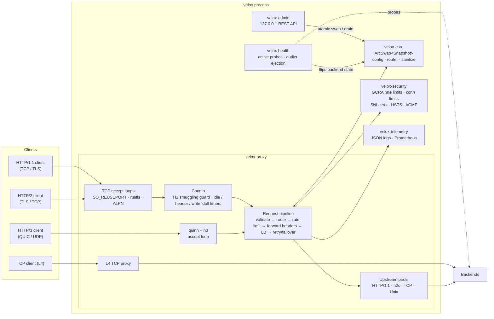

# Velox

**A memory-safe reverse proxy and L4/L7 load balancer in pure Rust.**
HTTP/3 + HTTP/2 + HTTP/1.1 at the edge, pooled HTTP/1.1 / h2c / Unix sockets to your backends, zero-reload configuration, and request-smuggling defences that don't rely on the HTTP library's good manners.

| | |
|---|---|
| **Memory safety** | `#![forbid(unsafe_code)]` in every crate. TLS is `rustls` (no OpenSSL). No `unwrap`/`expect`/`panic` in library code — enforced by `clippy` in CI. |
| **Smuggling-proof parsing** | HTTP/1 bytes are validated *before* `hyper` sees them. Ambiguous framing (CL+TE, TE.TE, duplicate/odd `Content-Length`, obs-fold, bare LF, NUL, `Transfer_Encoding`…) is rejected with a clean 4xx — and **not one byte of a rejected request reaches your backend**. |
| **Zero-reload config** | Lock-free `arc-swap` snapshots. Edit `velox.toml` (`velox reload` / `SIGHUP`) or call the admin API. In-flight requests finish on the config they started with; keep-alive connections never drop; an invalid change is rejected with no side effects. |
| **Edge protocols** | HTTP/3 (QUIC, `quinn` + `h3`), HTTP/2 and HTTP/1.1 (`hyper`). TCP responses advertise `Alt-Svc: h3=":443"; ma=86400`. |
| **Load balancing** | Weighted round-robin, least-connections, power-of-two-choices, consistent hashing (Ketama ring). Active health checks with jitter + hysteresis, passive outlier ejection with exponential back-off. |
| **Operable** | Prometheus `/metrics`, JSON logs with `X-Request-Id` correlation, graceful drain on `SIGTERM`, localhost-only admin API. |

---

## Contents

- [Quickstart](#quickstart)
- [Architecture](#architecture)
- [Security model](#security-model)
- [Configuration](#configuration)
- [Admin API](#admin-api)
- [Operations](#operations) (signals, reloads, draining, metrics, logs)
- [Docker](#docker)
- [ACME / Let's Encrypt](#acme--lets-encrypt)
- [Testing](#testing) (unit, end-to-end, property tests, fuzzing)
- [Benchmarks](#benchmarks)
- [Known limitations](#known-limitations)

---

## Quickstart

```bash
# Rust 1.88+
cargo build --release          # → target/release/velox  (~5 MB: fat LTO, stripped, panic=abort)
cargo test --workspace --all-features

# two throwaway backends
python3 -m http.server 3000 &  python3 -m http.server 3001 &

./target/release/velox validate -c velox.toml   # checks everything, reports all problems at once
./target/release/velox start    -c velox.toml
```

```bash
curl -i  http://127.0.0.1:8080/                       # HTTP/1.1
curl -ik https://127.0.0.1:8443/ --http2              # HTTP/2 (self-signed dev cert); note the Alt-Svc header
curl -ik https://127.0.0.1:8443/ --http3-only         # HTTP/3 (needs a curl built with HTTP/3)

curl -s http://127.0.0.1:9901/admin/v1/upstreams | jq # live view of every backend
curl -s http://127.0.0.1:9901/metrics | head          # Prometheus
./target/release/velox reload                         # re-read velox.toml, no dropped connections
```

CLI:

| Command | What it does |
|---|---|
| `velox start -c velox.toml` | Run. `SIGTERM`/`SIGINT` drain gracefully, `SIGHUP` reloads. |
| `velox validate -c velox.toml` | Validate (including that cert files exist). Exit code ≠ 0 on any problem. |
| `velox reload [-c velox.toml] [--admin 127.0.0.1:9901]` | Ask a running instance to re-read its file via the admin API (`VELOX_ADMIN_TOKEN` is honoured). |
| `velox version` | Print the version. |

The annotated [`velox.toml`](velox.toml) documents every option.

---

## Architecture



### Crates

| Crate | Responsibility |
|---|---|
| [`velox-core`](crates/velox-core) | `velox.toml` schema + validation; `SharedState` (`ArcSwap<Snapshot>`); host/path router; backend runtime state; **`sanitize`**: the strict HTTP layer (wire-level HTTP/1 guard, typed header validation, hop-by-hop stripping, `X-Forwarded-*`/`Forwarded` handling). |
| [`velox-proxy`](crates/velox-proxy) | Dual-stack listeners (TCP + UDP), TLS/ALPN, HTTP/1.1 · HTTP/2 · HTTP/3 front-ends, the request pipeline, load balancers, pooled upstream clients (TCP/Unix, h1/h2c), WebSocket tunnelling, L4 proxy, graceful shutdown. |
| [`velox-health`](crates/velox-health) | Background TCP/HTTP probes (interval, timeout, jitter, thresholds) and passive outlier detection. |
| [`velox-security`](crates/velox-security) | Lock-free token-bucket rate limiting (GCRA on `DashMap` + atomics), per-IP/global connection caps, `rustls` SNI resolver with hot-swappable certs, HSTS/security headers, ACME HTTP-01. |
| [`velox-telemetry`](crates/velox-telemetry) | `tracing` JSON logging and the `velox_*` Prometheus registry. |
| [`velox-admin`](crates/velox-admin) | Localhost REST API and the optional metrics-only listener. |
| [`velox-cli`](crates/velox-cli) | The `velox` binary (`start`, `validate`, `reload`, `version`) and the `App` that wires everything (also used by the end-to-end tests). |

### Request lifecycle

1. **Accept** — per-IP and global connection caps (IPv6 grouped by /64); `TCP_NODELAY` + keep-alive probes; TLS/QUIC handshake under a deadline.
2. **Guard** (HTTP/1) — `ConnIo` withholds each request head until it is complete *and* valid, then releases it to `hyper`. See [Security model](#security-model).
3. **Validate** — typed checks for every protocol (`Host`/`:authority` agreement, CL/TE rules, connection-specific headers in h2/h3, header-count cap).
4. **Route** — one `ArcSwap` load; exact host → wildcard → catch-all, longest path prefix on segment boundaries.
5. **Rate limit** — GCRA bucket per client IP or header value → `429` + `Retry-After`.
6. **Forward headers** — hop-by-hop stripped (including `Connection`-nominated names), `X-Forwarded-For/Proto/Host`, `X-Real-IP`, RFC 7239 `Forwarded` rebuilt (untrusted peers cannot spoof them), `X-Request-Id` minted or propagated.
7. **Balance + forward** — pick a backend in O(1), send over a pooled connection, fail over to *another* backend on connect errors (and on timeouts for idempotent requests) — **all attempts share one `upstream_response` deadline** (see below); record the outcome for outlier detection.
8. **Respond** — hop-by-hop stripped, HSTS / `nosniff` / `Alt-Svc` / `X-Request-Id` added, body streamed under an idle-timeout, metrics and access log emitted.

Every failure maps to one status: `400/431/501` (rejected input), `404` (no route), `408`, `413`, `429`, `502`, `503`, `504`. Nothing on this path can panic.

---

## Security model

### Request smuggling

Smuggling needs two parties to disagree about where a request ends. Velox removes the disagreement instead of hoping both sides normalise the same way:

* **Before `hyper`.** `velox-core::sanitize::h1` is a sans-IO state machine fed every byte read from the client. It tracks message boundaries across keep-alive and pipelining (Content-Length bodies, chunked bodies including trailers) and enforces, per RFC 9110/9112:
  * exactly one `Host` (HTTP/1.1), syntactically valid (no userinfo, spaces, paths…);
  * at most one `Content-Length`, digits only; **never** together with `Transfer-Encoding`;
  * `Transfer-Encoding` must be exactly `chunked` (so `xchunked`, `chunked, identity`, `\x0bchunked`… are refused; a clean-but-unsupported coding list is a `501`);
  * no obs-fold, no bare CR/LF, no NUL/control bytes, no `Connection: Content-Length`-style nominations, no `Transfer_Encoding`-style aliases;
  * origin-form request targets only; `CONNECT`/`TRACE` refused; hard caps on head size, header count and URI length;
  * chunk sizes are strict hex with an overflow bound; trailers may not smuggle framing headers.
* **Partial heads are withheld.** A request head is held back until the *entire* head has been validated. This closes the classic gap where early bytes of a poisoned head are forwarded before the violating header arrives. A rejection is delivered to `hyper` as a synthetic `Connection: close` request so the client gets a normal `400`, and the attacker's bytes are discarded. (Integration test: nothing from a poisoned pipelined chunk reaches the backend.)
* **After `hyper` — and for h2/h3.** The same rules run on typed headers, plus h2/h3-specific ones (no `Connection`, `Keep-Alive`, `Transfer-Encoding`, `Upgrade`, `TE` ≠ `trailers`; `:authority` must match `Host`).
* **WebSocket upgrades** are honoured only for `Upgrade: websocket` (never `h2c`), must carry no body, and if the backend declines the upgrade the connection is closed rather than reused.

### Host, redirects and retries

* **Strict `Host` labels.** Labels are RFC 1123 (`[A-Za-z0-9-]`, no leading/trailing hyphen); `_` is rejected unless you set `security.allow_underscores_in_host = true` (useful for container service names; it relaxes *only* `_`). The switch applies to the HTTP/1 wire guard, the HTTP/2/3 typed check and route/SNI host patterns.
* **No open redirects.** `redirect_https` on a catch-all route (`hosts = []`) would reflect whatever `Host` the client sent into `Location`, so validation **refuses** that configuration unless the route sets `canonical_host`. A request with no host at all (HTTP/1.0) gets a `400` rather than a redirect, and `OPTIONS *` redirects to `/`.
* **One deadline for all retry attempts.** Failover attempts share a single `upstream_response` (or per-route `timeout`) budget, so `retries = 2` can no longer triple the worst-case latency. The trade-off is deliberate: an attempt that burns the whole budget on a *hung* backend ends the request with `504` instead of trying another node; connect failures (the common failover case) are still retried immediately, and hung backends are removed from rotation by outlier detection and health checks.
* **No redirect loops behind a TLS-terminating load balancer.** When a request arrives on the plain listener from a peer in `security.trusted_proxies` that says the client used HTTPS (`X-Forwarded-Proto: https`, or `Forwarded: …;proto=https`; for a comma list the client-most entry counts), `redirect_https` does **not** redirect — otherwise the load balancer would follow the `308` straight back to the same plain hop forever. The claim is honoured only from trusted peers, so an ordinary client cannot use the header to skip the redirect; the upstream sees the normalised `X-Forwarded-Proto: https`.
* **HTTP/3 bodies.** `Content-Length: 0` spawns no body task at all (nothing lingers on the stream), and a `GET`/`HEAD`/`DELETE`/`OPTIONS` without a length gets a non-blocking look at whether its stream already ended instead of a timed wait; `POST`/`PUT`/`PATCH` streams are forwarded immediately. Otherwise the body is pumped on its own task, so routing and `413`/`429` decisions never wait for the first frame. `Content-Length` is enforced against the bytes that actually arrive (too many *or* too few ⇒ `400`, never a silent truncation), trailers — including trailers-only requests — are forwarded, and a stalled body gets a real `408`. (An HTTP/3 request whose *headers* never arrive has no stream to answer on, so it is reset.)

### Denial of service

Every stage has a bound — see `[limits]` and `[timeouts]` in [`velox.toml`](velox.toml): TLS/QUIC handshake, **header read (Slowloris)**, idle keep-alive, client body idle, upstream connect, upstream response, upstream body idle, **write stall (slow-read)**; max header bytes/count/URI, body size, connections (global and per IP), concurrent streams; HTTP/2 rapid-reset limits; QUIC address validation under load; bounded rate-limiter memory. When a shard of the limiter is full, inserting a new key evicts one entry *from that shard* (an expired bucket first, otherwise the closest to refilling after a bounded clock sweep). Eviction only ever makes the evicted key more permissive, so a flood of fabricated source keys cannot throttle new legitimate users; the cost is that an attacker able to mint hundreds of thousands of source keys can reset *other abusers'* penalty state.

### Admin API

Loopback bind (enforced when the config is validated *and* when binding), loopback peer check, `Host` must be a loopback name (DNS-rebinding), requests with `Origin`/`Sec-Fetch-Site` are refused (browser CSRF), JSON content-type required for bodies, constant-time bearer-token check (`admin.token_env`), 1 MiB body cap.

---

## Configuration

See the commented [`velox.toml`](velox.toml). Highlights:

```toml
[[upstream]]
name      = "app"
algorithm = "p2c"                    # round_robin | least_conn | p2c | consistent_hash
backends  = [{ addr = "10.0.0.5:8080", weight = 2 }, { addr = "unix:/run/app.sock" }]
[upstream.health]  { path = "/healthz", interval = "5s", jitter = 0.2, healthy_threshold = 2, unhealthy_threshold = 3 }
[upstream.outlier] { consecutive_failures = 5, base_ejection_time = "30s", max_ejection_percent = 50 }

[[route]]
hosts = ["example.com", "*.example.com"]
path_prefix = "/api"
strip_prefix = true
upstream = "app"
rate_limit = { requests_per_second = 20.0, burst = 40, key = "header:x-api-key" }
```

### HTTPS and mTLS to backends

An `https://host[:port]` backend address (default port 443) makes Velox originate TLS (`rustls`, TLS 1.2/1.3):

```toml
[[upstream]]
name     = "payments"
protocol = "h2"                        # ALPN h2 over TLS (or "http1" for http/1.1)
backends = [{ addr = "https://payments.internal:8443" }, { addr = "https://10.1.0.7:8443" }]
max_inflight = 100
[upstream.tls]
ca_file          = "/etc/velox/internal-ca.pem"   # trust only your private CA
client_cert_file = "/etc/velox/client.crt"        # mTLS identity
client_key_file  = "/etc/velox/client.key"
server_name      = "payments.internal"            # SNI + name checked (default: the backend host)
```

* **Verified by default**: public web PKI (bundled Mozilla roots) unless `ca_file` is given, in which case *only* that bundle is trusted. Names are checked against DNS or IP SANs; a mismatch is a `502` and counts in `velox_upstream_tls_errors_total`. `insecure_skip_verify = true` exists for lab use and is off unless you ask for it.
* **Rotation without a reload**: `ca_file` and the client certificate/key are re-checked every `reload_interval` (default 5 s). New connections use the new identity; a half-written rotation keeps the last good configuration instead of taking traffic down.
* One pool may mix `https://`, `host:port` and `unix:` backends. Active health checks complete the TLS handshake first (a `tcp` check on an `https://` backend therefore proves the TLS service is up, not only the port). With `protocol = "h2"` or `"h2c"` the HTTP probe is a real HTTP/2 request (over TLS it requires ALPN to actually negotiate `h2`; a backend that does not fails the probe rather than being probed with the wrong protocol), so HTTP/2-only backends get genuine `kind = "http"` health checks.
* `[[tcp_proxy]]` relays bytes and does not originate TLS, so its upstreams cannot contain `https://` backends (rejected at validation).

### Per-backend circuit breaker (`max_inflight`)

`max_inflight` on an upstream (default for every backend) or on a single backend caps its concurrent requests. The cap is enforced with one atomic compare-and-swap, so concurrent requests can never overshoot it. A full backend is skipped by every algorithm (round-robin, least-conn, P2C, consistent-hash walk to the next ring owner); when **all** eligible backends are full the client gets an immediate `503` with `Retry-After: 1` and `velox_upstream_saturated_total` counts it. An outage ("nothing healthy") is reported separately as `no healthy upstream`, so alerts can tell overload from failure. Caps apply on reload to backends that keep their runtime state; the admin API shows `max_inflight` and `saturated` per backend.

### PROXY protocol (v1 and v2)

```toml
[server]
http_addr  = "0.0.0.0:80"
https_addr = "0.0.0.0:443"
proxy_protocol         = true
proxy_protocol_trusted = ["10.0.0.0/8"]      # the NLB / HAProxy addresses; required
```

The header is read **before** TLS or HTTP, consuming exactly its bytes (a `ClientHello` in the same segment is untouched). The client address it carries replaces the TCP peer everywhere: access logs, rate limiting, per-IP connection limits (the load balancer's own address is only subject to the global cap while the header is pending), `X-Forwarded-For`/`X-Real-IP`. Safety properties: peers outside `proxy_protocol_trusted` are refused immediately; the header is mandatory (unframed HTTP/TLS is dropped, never interpreted); v1 is capped at 107 bytes and v2 at 1 KiB of payload; the whole read is bounded by `timeouts.header_read`; v2 `LOCAL` and v1 `UNKNOWN` (load-balancer health probes) fall back to the TCP peer; v2 TLVs are skipped. Because the real client is *not* itself a trusted proxy, its own `X-Forwarded-*` headers are discarded as usual. Counted in `velox_proxy_protocol_errors_total{reason}`. `[[tcp_proxy]]` listeners take `proxy_protocol = true` too (the header is consumed, not forwarded). HTTP/3 runs on UDP, which PROXY protocol does not cover. Changing it requires a restart.

### Response compression

```toml
[compression]
enabled = true            # opt-in; per-route override with `compress = true|false`
algorithms = ["zstd", "br", "gzip"]
min_size = 1024
```

`Accept-Encoding` is negotiated per RFC 9110 (`q` values, `*`, `identity`; your `algorithms` order breaks ties). Responses are compressed **as a stream** in 64 KiB slices: memory per response is bounded, and the encoder is flushed whenever the upstream pauses (and every 256 KiB regardless), so NDJSON/long-poll style bodies are not held back. The response gets `Content-Encoding`, `Vary: Accept-Encoding` (also on responses that *could* have been compressed but went out identity, so shared caches stay correct), no `Content-Length`, a weak `ETag`, and no `Accept-Ranges`. Skipped — and left byte-for-byte untouched — for already-encoded bodies (never double-compressed), bodies smaller than `min_size`, types outside `content_types`, `text/event-stream`, `application/grpc*`, `Cache-Control: no-transform`, `206`/`Content-Range`, `1xx`/`204`/`304`, and `HEAD` (which only gets `Vary`). Works identically over HTTP/1.1, HTTP/2 and HTTP/3; `velox_compression_responses_total` and `velox_compression_bytes_total{direction}` report the savings. gzip and brotli are pure Rust; zstd uses `libzstd` through the `zstd` crate (the one C dependency besides `ring`).

**Protecting the event loop.** Compression is CPU work, so it never runs on the async worker threads for anything big: slices of at least `offload_threshold` bytes (default 32 KiB) are compressed on a small dedicated pool of OS threads (`worker_threads`, default one per CPU, 2–16) while only that response waits, so a multi-megabyte download cannot stall other connections scheduled on the same runtime thread. (A test runs an 8 MiB, best-level gzip on a single-threaded runtime next to a 1 ms ticker and fails if the loop stalls for 150 ms; forcing the work back inline fails it.) The pool is separate from Tokio's blocking pool, which also serves DNS and file I/O. Memory is bounded by `max_concurrent_encoders` (default 256): each in-flight compressed response holds one encoder, and when all slots are taken further compressible responses simply go out **uncompressed** — compression is an optimisation, it never queues or fails traffic. That fallback is decided before any header is rewritten, so such a response keeps its `Content-Length` and strong `ETag` (it still gets `Vary`). Watch `velox_compression_encoders_active`, `velox_compression_skipped_total{reason="saturated"}` and `velox_compression_offload_jobs_total`; if no worker thread can be started at all, large slices degrade to inline compression instead of failing.

### Response cache

```toml
[cache]                               # sizing, shared by every route that opts in
max_bytes       = 67108864            # 64 MiB in total
max_entry_bytes = 1048576             # larger bodies stream through uncached
shards          = 16

[[route]]
upstream = "app"
cache = { default_ttl = "30s", max_ttl = "1h" }   # `cache = {}` enables it with defaults
```

An in-memory, sharded, byte-bounded **LRU** for `GET` (and `HEAD`, answered from a stored `GET`). Each shard has its own lock, held only for map operations; hits clone reference-counted `Bytes`, never copy bodies. On a miss the response streams to the client unchanged while a bounded copy is collected, and the entry is stored only if the body ended cleanly, matched its declared length and stayed under `max_entry_bytes` — a client that disconnects mid-download leaves nothing behind. (HTTP servers do not always poll for a body's final `None`, so completion is decided from the length / end-of-stream signals; this was found by the integration tests.)

What is cached is deliberately conservative — Velox implements the shared-cache subset of RFC 9111 and does not guess:

* **Freshness must be stated**: `s-maxage`, else `max-age`, else `Expires` (relative to `Date`), minus `Age`; or the route's `default_ttl`. No heuristic freshness. `max_ttl` caps whatever the backend asks for. An invalid `max-age` means stale.
* **Never stored**: `no-store`, `private`, `no-cache`, `Set-Cookie`, `Vary: *`, `Pragma: no-cache`, partial content, responses with trailers, and statuses outside 200/203/204/300/301/308/404/405/410/414/501.
* **Never touches the cache**: requests with `Authorization`, `Range`/`If-Range`, a body or `Upgrade`, `Cache-Control: no-store`, and — **by default — a `Cookie`**: a backend that personalises on cookies without `Vary: Cookie`/`private` would otherwise show one visitor's page to another. Set `allow_cookies = true` only on routes whose cacheable responses never depend on cookies. `no-cache` / `max-age=0` / `Pragma: no-cache` skip the lookup but refresh the entry.
* **`Vary`** is honoured: each URL holds up to 8 variants keyed on the stored request header values. **Conditionals** work from the cache: `If-None-Match` (weak comparison, `*`) and `If-Modified-Since` produce `304` without contacting the backend.
* **Keys** are route + host (case-insensitive) + scheme + path and query. HTTP and HTTPS are separate because Velox tells the backend which one the client used. `ignore_query = true` drops the query for busting parameters.
* **Invalidation**: a successful `POST`/`PUT`/`PATCH`/`DELETE` to a URL drops it (RFC 9111 §4.4), and the admin API purges on demand.
* Compression and CORS are applied **per client on the way out**, to hits and misses alike, so one stored object serves identity, gzip and brotli clients and every allowed origin.
* Every response on a caching route carries `X-Velox-Cache: HIT | MISS | PASS | BYPASS | STALE | REVALIDATING` (and cached responses carry `Age`).

```bash
curl -XPOST localhost:9901/admin/v1/cache/purge -H 'content-type: application/json' \
     -d '{"path_prefix": "/static/", "route": "site"}'      # → {"purged": 12}
curl localhost:9901/admin/v1/cache                           # entries, bytes, hits, misses, evictions
```

Purge selectors are `all`, `route`, `host`, `path` (exact, with query) and `path_prefix`, ANDed; a request that selects nothing is refused (`{}` never means "everything"). Metrics: `velox_cache_hits_total{route}`, `velox_cache_misses_total{route}`, `velox_cache_bypass_total{reason}`, `velox_cache_stores_total`, `velox_cache_evictions_total`, `velox_cache_purged_total`, and the `velox_cache_entries` / `velox_cache_bytes` gauges. **Caveats**: it assumes the backend's answer depends only on method, URL, host and its own `Vary` headers — do not cache routes that personalise by client IP (`X-Forwarded-For`) or other unkeyed headers. Each in-flight cacheable miss buffers up to `max_entry_bytes`.

#### Stampede protection and stale serving

```toml
cache = { coalesce = true, coalesce_timeout = "10s", stale_while_revalidate = "30s", stale_if_error = "5m" }
```

* **Request coalescing (singleflight).** When many requests miss on the same object at once, only the first (the *leader*) goes to the backend; the rest wait for it and are answered from what it stored (`velox_cache_coalesced_total`). "Same object" means the same URL *and* the same values of the headers the stored response varies on, so French and English requests do not queue behind each other. The leader's claim is released whichever way its fetch ends — stored, not cacheable, failed, or the client hanging up mid-download — and then waiting requests simply fetch for themselves: a non-cacheable response or a failing leader never makes followers inherit the outcome or wait in line. Waiting is bounded by `coalesce_timeout` (`velox_cache_coalesce_timeouts_total`); `coalesce = false` turns it off. Ten simultaneous misses on a 300 ms backend make **one** backend request and finish in about one round trip.
* **`stale-while-revalidate` (RFC 5861).** Within the window a response's own `stale-while-revalidate=N` directive (or the route default) allows, an expired entry is served **immediately** (`X-Velox-Cache: REVALIDATING`) while **one** background request refreshes it, however many clients arrive meanwhile. The refresh is conditional (`If-None-Match` / `If-Modified-Since` from the stored validators), so an unchanged object costs a `304`, not a body; a changed one replaces the entry. It runs through the normal pipeline but speaks for the object, not for the client that triggered it: cookies, `Authorization`, ranges and the client's own conditionals are dropped, and it is never counted against that client's rate limit or ACLs. A failing refresh leaves the stale copy to serve out its window.
* **`stale-if-error` (RFC 5861).** If the backend fails — connect error, timeout, `500`/`502`/`503`/`504` — an expired entry still inside its window is served instead (`X-Velox-Cache: STALE`), so a backend outage looks like a slightly old page, not an error. Past the window the failure is the client's again.
* **Limits.** `must-revalidate` / `proxy-revalidate` switch both off for that response (RFC 9111 forbids serving it stale); an invalid directive value counts as absent; no window exceeds 24 h whatever is configured. Route-level `stale_while_revalidate` / `stale_if_error` supply defaults for backends that say nothing. Metrics: `velox_cache_stale_served_total{route,kind=swr|sie}`, `velox_cache_revalidations_total{route,result=updated|not_modified|error}`.

### CORS

```toml
[[route]]
upstream = "api"
[route.cors]
allow_origins  = ["https://app.example.com", "https://*.example.com"]   # or ["*"] (no credentials)
allow_methods  = ["GET", "POST", "PUT"]         # default GET, HEAD, POST; "*" = any
allow_headers  = ["content-type", "authorization"]   # "*" = whatever the preflight asks for
expose_headers = ["x-request-id"]
allow_credentials = true
max_age = "10m"
```

Preflights (`OPTIONS` + `Origin` + `Access-Control-Request-Method`) are answered by Velox with `204` and never reach the backend; a disallowed origin, method or header gets `403` with no `Access-Control-*` headers (`velox_cors_denied_total{route,reason}`). On real requests the edge policy **replaces** whatever `Access-Control-*` the backend set, so one policy governs everything — including Velox's own `429`/`502`, which would otherwise show up in a browser as an opaque CORS error. `Vary: Origin` is added whenever the answer depends on the origin. Origin matching is exact (scheme, host and port, case-insensitive) or `scheme://*.host` for subdomains with at least one extra label (`*.example.com` matches neither `example.com` nor `evilexample.com`); `*` together with `allow_credentials` is rejected when the configuration loads.

### Trace context (`traceparent`)

`telemetry.traceparent = true` makes every proxied request carry a valid [W3C `traceparent`](https://www.w3.org/TR/trace-context/): a valid inbound one is **continued** (same trace id and sampling flags, a fresh span id for Velox's hop), a missing or malformed one — wrong widths, uppercase hex, all-zero ids, version `ff`, several header lines — is replaced by a freshly minted sampled trace. `tracestate` travels only with a valid `traceparent` and only if printable ASCII within 512 bytes. The trace id is added to the access log (`trace_id`), so logs, Velox and the backends line up.

### DNS refresh for multi-address backends

```toml
[[upstream]]
name = "orders"
backends = [{ addr = "orders.default.svc.cluster.local:8080" }]
dns = { refresh_interval = "10s", max_addrs = 64, ipv6 = true }
```

With a `dns` table, every hostname backend (and `https://` ones) is looked up on its own schedule and becomes **one pool member per address**, each with its own health, ejection, `max_inflight` and in-flight accounting (the admin API shows `resolved_from`). A refresh that returns the same set changes nothing; a changed answer adds members and retires vanished ones **without touching survivors**: they keep their identity, drain flag and pooled connections, and requests already running on a retired member finish normally (an end-to-end test holds a request on an address that DNS then removes). A failed or empty lookup keeps the last good answer and retries sooner, so a DNS outage cannot empty a pool; answers are sorted and capped at `max_addrs`, so every Velox instance picks the same members from an oversized record set. For `https://` backends the certificate is verified against the **host name**, not the address it resolved to (unless `tls.server_name` says otherwise). Before the first answer the hostname backend works as before (the OS resolves it per connection). Metrics: `velox_dns_resolutions_total{upstream,result}`, `velox_dns_changes_total`.

### Client certificates (inbound mutual TLS)

```toml
[tls]
client_ca_file       = "/etc/velox/client-ca.pem"   # CAs client certificates must chain to
# client_auth_required = true                        # default; false = anonymous clients allowed too
```

The HTTPS **and HTTP/3** listeners verify client certificates against the bundle. With `client_auth_required` (the default) a client without a valid certificate is refused during the handshake, before any HTTP is parsed (`velox_tls_handshake_errors_total`); with `false`, anonymous clients are served but a certificate that *is* presented must still verify. The verified identity reaches the backend as **`X-Client-Cert-Subject`** and **`X-Client-Cert-Serial`** (subject escaped so it cannot inject a header, serial in hex). These headers are **always stripped from clients first**: whatever a client sends is discarded, and the only identity forwarded is the one Velox's own handshake verified — or, if there was none, what a peer in `security.trusted_proxies` (a proxy that terminated mTLS itself) passed on. A certificate Velox verified always overrides a forwarded claim. Requests carrying a verified identity never use the response cache (the backend may personalise on it).

The CA bundle **hot-reloads** on `SIGHUP` / `velox reload` / `POST /admin/v1/reload`: the verifier is swapped atomically, so handshakes in flight finish against the old bundle, new ones use the new one, and the listener's TLS session state survives. A bundle that fails to load rejects the whole reload and keeps the old one; removing `client_ca_file` and reloading turns client authentication off. Velox does not advertise a list of acceptable CA names in the handshake (as Envoy by default), which only matters to browsers with many client certificates. No CRL/OCSP checking is done: revoke by rotating the CA bundle or short-lived certificates.

### IP access lists

```toml
[security]
ip_allow = ["10.0.0.0/8", "2001:db8::/32"]   # if non-empty, only these may use any route
ip_deny  = ["10.6.6.0/24"]                    # always refused; deny beats allow

[[route]]
hosts    = ["admin.example.com"]
ip_allow = ["10.1.0.0/16"]                    # narrows further for this route
```

Lists are matched against the **resolved client address** — after PROXY protocol and `trusted_proxies` — so a deny rule judges the real client, not the load balancer, and a client cannot launder itself by prepending a harmless `X-Forwarded-For` entry (the chain is walked right-to-left past trusted hops only). IPv4-mapped IPv6 addresses (`::ffff:203.0.113.9`, which dual-stack sockets report) are matched as the IPv4 they carry, so a v4 deny rule cannot be sidestepped by the socket family. Global and route lists **both** apply, so a route can only narrow access. A refused client gets a bare `403` (no hint which list matched) *before* the HTTPS redirect, the rate limiter, CORS, JWT or any backend work; `velox_acl_denied_total{route,scope,reason}` counts them. Lists are evaluated per request (a linear scan: fine for hundreds of CIDRs), apply to L7 routes only, and reload live.

### JWT verification at the edge

```toml
[[route]]
upstream = "api"
[route.jwt]
algorithms     = ["RS256", "ES256"]               # allow-list; default; HS256 must be listed explicitly
jwks_file      = "/etc/velox/jwks.json"           # or public_key_file = "pub.pem" (SPKI), or secret_file / secret_env (HS256)
issuer         = "https://login.example.com"
audience       = ["api"]
leeway         = "30s"
forward_claims = ["sub", "roles", "tenant_id"]    # → X-Jwt-sub, X-Jwt-roles, X-Jwt-tenant_id
# required = true   header = "authorization"   scheme = "Bearer"   require_exp = true   reload_interval = "5s"
```

Invalid tokens are refused with `401` and `WWW-Authenticate: Bearer realm="velox", error="invalid_token"` (a missing one gets the plain challenge, RFC 6750) **before** the request reaches the backend; the response never says *why* (`velox_jwt_rejected_total{route,reason}` does). The verifier is deliberately strict:

* **Only the listed algorithms** (`HS256`, `RS256`, `ES256`); `alg: none` and everything else is refused, names case-sensitively. Each key has a *type* and is only tried for the matching algorithm, which closes the classic confusion attack (an HS256 token "signed" with the RSA public key as the secret is rejected — there is a test that mounts it). A `crit` header is refused; tokens over 8 KiB are refused before parsing; two `Authorization` headers are ambiguous and refused.
* **Claims**: `exp` is required and must be a number (disable with `require_exp = false`); `nbf` is enforced; `iss` must equal the configured issuer; `aud` (string or array) must contain a configured audience; `leeway` (at most 5 minutes) absorbs clock skew. Signatures use `ring` and are constant-time. HS256 secrets must be at least 32 bytes.
* **Keys**: `public_key_file` takes PEM `PUBLIC KEY` blocks (RSA 2048–8192 or P-256); `jwks_file` takes a JWKS with RSA and P-256 keys selected by `kid` (keys marked `use: enc` are skipped, symmetric `oct` keys are rejected). Key files are re-checked every `reload_interval`: a rotation is picked up without a reload, and a half-written or unreadable file **keeps the last good keys** rather than locking everyone out. `velox validate`, startup and every reload parse the key material, so a bad file fails there with a clear message instead of on the first request.
* **Anti-spoofing**: on a JWT route any client-sent `X-Jwt-*` header is deleted; only `forward_claims` from a verified token are added (strings, numbers, booleans and string arrays; nested values and anything unprintable are dropped).
* `required = false` admits anonymous requests but still verifies any token that *is* presented. CORS preflights are answered before authentication (browsers cannot send credentials on them), and the `401` itself carries the route's CORS headers. A JWT route may use the response cache only if the token travels in `Authorization` (such requests never touch the cache); any other `header` plus `cache` is rejected at validation, since one token holder's response could otherwise be served to another.

### Allocator, multi-core tuning and `velox doctor`

**Allocator.** The `velox` binary registers [mimalloc](https://github.com/microsoft/mimalloc) as its global allocator (default-on cargo feature `mimalloc`). Only `velox-cli` does so; every library crate keeps `#![forbid(unsafe_code)]` and no opinion about allocation. Build with `cargo build --release --no-default-features` for the system allocator. `bench/alloc_compare.sh` builds both and alternates runs; see [Benchmarks](#benchmarks) for what it measured here (and why you should measure on your hardware before relying on it).

**Multi-core listeners.** One accept loop is plenty for most deployments; when a single core saturates on `accept()` (very high connection churn, no keep-alive), raise `server.accept_workers` with `server.reuse_port = true`: each worker gets its own `SO_REUSEPORT` socket and the kernel spreads incoming connections across them without a shared accept queue or lock. Rules of thumb:

* `accept_workers` ≤ the number of cores; leave cores for the worker threads that run requests. Past the core count it only adds contention (`velox doctor` warns).
* Without `reuse_port` the workers share one socket and wake up together on each connection — keep `reuse_port = true` whenever `accept_workers > 1`.
* Tokio's runtime already uses one worker thread per core; `SO_REUSEPORT` spreads *accepts*, not request processing. Velox does **not** pin threads or accept loops to cores (that needs `sched_setaffinity`, i.e. `unsafe`/libc, which this codebase forbids); if you want pinning or NUMA locality, apply it from outside with `taskset`/`numactl`, systemd `CPUAffinity=`, or the Kubernetes CPU manager (`static` policy) and size `accept_workers` and `TOKIO_WORKER_THREADS` to the cores you grant. The hash the kernel uses is per 4-tuple, so a few very busy clients can still land on one worker.
* On Linux give the process room: `LimitNOFILE` ≥ about `2 × limits.max_connections + 512` (a client socket plus a pooled upstream socket per connection), `net.core.somaxconn` ≥ `server.backlog`, and — for HTTP/3 — `net.core.rmem_max` / `wmem_max` ≥ ~7 MiB so QUIC does not drop packets under load.

**`velox doctor -c velox.toml`** checks all of that before launch and tells you the command that fixes each finding:

```text
[ OK ] config         velox.toml parses and validates
[ OK ] allocator      mimalloc (compiled in)
[FAIL] fd-limit       1024 descriptors cannot serve limits.max_connections = 10000 (about 20512 needed): accepting would fail with EMFILE
                      fix: raise the hard limit (currently 4096): LimitNOFILE=20512 in the systemd unit or `--ulimit nofile=20512` for Docker
[WARN] udp-buffers    net.core.rmem_max = 212992, wmem_max = 212992: QUIC wants at least 7340032; HTTP/3 will drop packets and stall under load
                      fix: sysctl -w net.core.rmem_max=7500000 net.core.wmem_max=7500000   # persist in /etc/sysctl.d/
[ OK ] tls-expiry     /etc/velox/site.crt: 63 day(s) left
[WARN] listeners      http 0.0.0.0:80 is already in use (is another velox, or something else, running?)
```

It covers: configuration validity (including key files, JWT keys and the client CA bundle), the open-files limit against `max_connections` (fail below the client count, warn below the upstream-connection estimate), `rmem_max`/`wmem_max` for HTTP/3 and `somaxconn` against `server.backlog` (Linux; skipped elsewhere), `accept_workers` against the CPU count and `reuse_port`, certificate expiry for server certificates, the client CA bundle and upstream mTLS material (`--warn-days`, default 14; expired is a failure), and whether every listen address can be bound (privileged-port failures name `CAP_NET_BIND_SERVICE`). `--check-backends` also tries a TCP connection to each backend, `--json` emits machine-readable output, and `--strict` makes warnings fail the exit code (for CI gates). Exit code `0` unless something failed.

### Upstream HTTP versions

An upstream that answers `HTTP/1.0` (legacy appliances, some CGI-era servers) no longer leaks that status line to clients: the response is normalised to `HTTP/1.1`, with status, headers and the body bytes untouched. A close-delimited upstream body becomes a properly framed chunked response, and keep-alive works toward the client even though the backend hop never could.

**What reloads live?** Routes, upstreams (including backend sets/weights/algorithms), health and outlier settings, rate limits, limits and timeouts for *new* connections/requests, response headers, trusted proxies, TLS certificates. **What needs a restart?** Listener addresses and PROXY-protocol listener settings (`http_addr`, `https_addr`, `h3`, `h3_addr`, `server.proxy_protocol`, `[[tcp_proxy]]` listeners and their `proxy_protocol`). A reload that changes them applies everything else and logs a warning.

Backends that are unchanged across a reload keep their runtime state (health, drain flag, in-flight counters, ejection history) — a reload never "forgets" a drained or ejected node.

---

## Admin API

All under `http://127.0.0.1:9901`. Mutations take `Content-Type: application/json`. Failed validation → `422` and nothing changes.

| Method & path | Purpose |
|---|---|
| `GET /admin/v1/status` | version, config generation, uptime |
| `GET /admin/v1/config` | the live configuration as JSON |
| `POST /admin/v1/reload` | re-read `velox.toml` (what `velox reload` calls) |
| `GET /admin/v1/upstreams`, `GET …/{name}` | live state: health, drain, ejection, in-flight and lifetime counters per backend |
| `PUT /admin/v1/upstreams/{name}` | create or replace an upstream |
| `DELETE /admin/v1/upstreams/{name}` | remove (`409` while a route still uses it) |
| `POST /admin/v1/upstreams/{name}/backends/{addr}/drain` · `undrain` · `reset` | stop sending new requests (in-flight finish) · resume · clear ejection and mark healthy. `{addr}` is URL-encoded (`10.0.0.5%3A8080`) |
| `GET /admin/v1/routes` | routes with their ids |
| `PUT /admin/v1/routes` · `POST /admin/v1/routes` | replace all · append one |
| `PUT /admin/v1/routes/{id}` · `DELETE …/{id}` | replace · remove one |
| `GET /admin/v1/cache` | response-cache occupancy and counters (`404` if the admin API was built without a cache) |
| `POST /admin/v1/cache/purge` | drop cached entries: `{"all":true}` or any of `route`, `host`, `path`, `path_prefix` (ANDed); an empty request is refused |
| `GET /metrics`, `GET /healthz` | Prometheus text, liveness |

```bash
# Blue/green cut-over with zero dropped requests
curl -X PUT localhost:9901/admin/v1/upstreams/green -H 'content-type: application/json' \
     -d '{"name":"green","backends":[{"addr":"10.0.1.5:8080"}]}'
curl -X PUT localhost:9901/admin/v1/routes/site     -H 'content-type: application/json' \
     -d '{"upstream":"green"}'
# Take a node out of rotation, let it finish, then upgrade it
curl -X POST localhost:9901/admin/v1/upstreams/app/backends/10.0.0.5%3A8080/drain
```

API edits live in memory; the file is the source of truth for the next `velox reload`.

---

## Operations

* **Signals** — `SIGTERM`/`SIGINT`: stop accepting, send HTTP/2 `GOAWAY` / HTTP/3 `GOAWAY`, finish in-flight requests, exit `0` (after `server.drain_timeout` stragglers are closed). `SIGHUP`: reload the file.
* **Metrics** (`/metrics`)

  | Metric | Labels |
  |---|---|
  | `velox_http_requests_total` | `protocol` (`h1`/`h2`/`h3`), `status` |
  | `velox_http_request_duration_seconds` (histogram) | `protocol` |
  | `velox_upstream_responses_total` | `upstream`, `code` (`error` = no response) |
  | `velox_upstream_request_duration_seconds` (histogram) | `upstream` |
  | `velox_active_connections`, `velox_connections_total` | `protocol` |
  | `velox_connections_rejected_total` | |
  | `velox_tls_handshake_errors_total` | `transport` (`tcp`/`quic`), `reason` |
  | `velox_rate_limited_total` | `route` |
  | `velox_rejected_requests_total` | `reason` (e.g. `cl-te-conflict`) |
  | `velox_config_reloads_total`, `velox_config_generation` | `result` |
  | `velox_upstream_backend_healthy` / `_active_requests` / `_ejected` | `upstream`, `backend` |
  | `velox_upstream_backend_ejections_total` | `upstream`, `backend` |
  | `velox_h3_enabled` | |

* **Logs** — one JSON object per line. Each request produces an access-log event (`target: "velox::access"`) with `request_id`, `method`, `host`, `path`, `status`, `duration_ms`, `protocol`, `client_ip`, `route`, `upstream`, `backend`, `error`. The same `request_id` is sent upstream and returned to the client as `X-Request-Id` (an inbound value is reused only if it is a safe token ≤ 128 chars).

---

## Docker

```bash
docker build -t velox .
docker run --rm -p 8080:8080 -p 8443:8443 -p 8443:8443/udp velox
docker run --rm -v "$PWD/velox.toml:/etc/velox/velox.toml:ro" -p 8080:8080 -p 8443:8443 -p 8443:8443/udp velox
docker kill --signal=HUP <container>          # reload
```

Multi-stage build (`rust:slim` → `gcr.io/distroless/cc-debian12:nonroot`): no shell, no package manager, unprivileged user. Container defaults live in [`docker/velox.toml`](docker/velox.toml) (ports above 1024 because the image is not root).

---

## ACME / Let's Encrypt

Build with `--features acme` (`cargo build --release -p velox-cli --features acme`), add a `[tls.acme]` block, and keep `http_addr` reachable on port 80. Velox registers an account, answers HTTP-01 challenges on the cleartext listener (`/.well-known/acme-challenge/*`), writes the key (mode `0600`) and chain to `cache_dir`, installs the certificate into the SNI resolver **without a restart**, and renews ~30 days before expiry (renewal timing is derived from the cached file's age, assuming 90-day certificates). Use the Let's Encrypt *staging* `directory_url` while testing. Wildcard names need DNS-01 and are rejected by validation.

Honest status: the issuance flow is compiled and unit-tested (cache handling, resolver installation, unreachable-CA behaviour) but **has not been exercised against a live ACME CA** in this repository's tests.

---

## Testing

```bash
cargo test --workspace --all-features
cargo clippy --workspace --all-targets --all-features -- -D warnings
cargo fmt --all -- --check
```

| Layer | What is covered |
|---|---|
| **Unit** (`velox-core`) | Config validation; router precedence; atomic swap (including concurrent readers); **~25 smuggling cases** (CL.TE, TE.CL, TE.TE variants, duplicate CL, obs-fold, bare LF/CR, NUL/control bytes, underscore aliases, `Connection`-nominated framing headers, absolute-form, CONNECT/TRACE, size/count caps, chunk and trailer abuse); forwarded-header anti-spoofing; hash-ring stability. |
| **Property + mutation fuzz** (stable, in `cargo test`) | Guard never panics; verdict **and released bytes** independent of TCP segmentation; "accepted ⇒ unambiguous" invariants checked over 150 000 mutated smuggling seeds and 60 000 chunked streams. |
| **Unit** (others) | Load-balancer distribution (exact weighted RR, least-conn, P2C bias, hash minimal-disruption); GCRA bucket maths incl. 8-thread contention; connection limits; TLS SNI/reload; outlier back-off; probes; `ConnIo` timers (paused-time tests). |
| **Data plane** (`velox-proxy/tests`) | Real sockets: header rewriting, every attack in the smuggling list vs. a backend hit-counter (**must stay 0**), round-robin and failover, outlier ejection, 429, body limits, WebSocket tunnel, graceful drain, Slowloris, idle reaping, per-IP limits, Unix-socket upstream, 504. |
| **End-to-end** (`velox-cli/tests`) | **HTTP/1.1, HTTP/2 and HTTP/3** with real TLS/QUIC clients (incl. 100 KB uploads, 50 multiplexed streams, `Alt-Svc`, protocol metrics, cert hot-reload); failover + active-health recovery; passive ejection + admin reset; **zero-failure reconfiguration under load** (8 keep-alive connections across API edits, file reload and a rejected bad reload, with an in-flight request straddling the cut-over); consistent-hash pinning + drain; L4 proxy; and the **real `velox` binary** under `SIGTERM` (in-flight request completes, exit 0), `SIGINT`, `SIGHUP`, `velox reload`, `velox validate`. |
| **Backend TLS / mTLS** (`velox-cli/tests/e2e_upstream_tls.rs`) | A real TLS backend: custom-CA verification, SNI and name mismatch, untrusted certificate ⇒ `502` with no request sent, `insecure_skip_verify`, mTLS (anonymous client refused, identity seen by the backend), **live certificate rotation** and a broken rotation, ALPN `h2` vs `http/1.1`, mixed TLS/cleartext pools, TLS health probes flipping a backend down and up. |
| **Circuit breaker, PROXY protocol, compression** (`velox-proxy`) | `max_inflight`: exact cap under 16-thread contention, every balancer skips full backends, `503` fast-shed vs. outage; PROXY v1/v2: parser unit + property tests (every prefix is `Incomplete`), exact-consumption on real sockets, trust list, mandatory header, per-real-client limits, TLS and L4 behind it; compression: negotiation matrix, eligibility matrix, round-trips for each codec/level/frame shape, streaming flush latency, pass-through cases, and h1/h2/h3. |
| **Cache, CORS, DNS, trace context, H2 probes** | Cache: policy matrix (freshness sources, forbidden directives, invalid lifetimes), exact LRU eviction and byte accounting under 8-thread churn, `Vary` variants, `304`s, fill completeness (oversized, truncated, errored, trailers, client gone, and a consumer that never polls the final `None`), and end-to-end hit/miss/expiry/bypass/invalidation/cookie/scheme behaviour on h1/h2/h3 plus the admin purge API. CORS: origin-matching attack cases, preflight allow/deny, backend headers replaced on real, `429` and `502` responses. DNS: scripted resolver driving expansion, scale up/down, failure/empty answers, capping, survivors keeping state, in-flight request surviving removal, and TLS verified against the service name. `traceparent`: strict parser plus property tests. HTTP/2 probes against `h2c` and TLS (ALPN enforced). Compression: cap, offload and event-loop-stall tests. HTTP/1.0 backend normalisation. |
| **Coalescing and stale serving** (`velox-proxy`) | Ten concurrent misses ⇒ exactly **one** backend request (and followers fall back to their own fetch when the response is not cacheable, the leader fails, coalescing is off, or the wait times out); the flight is released on store / pass / error / client disconnect; flights are keyed on the stored `Vary`; `stale-while-revalidate` answers instantly from an expired entry, five concurrent stale requests ⇒ one conditional refresh, a `304` revives the stored body without re-sending it, a changed object replaces the stale one; `stale-if-error` over `500`/`503`/dropped connection, its window ending, `must-revalidate` forbidding it, and route-level defaults. |
| **Zero-trust edge** (`velox-cli/tests/e2e_mtls.rs`, `velox-proxy`, `velox-security`) | Real CA and client certificates over h1, h2 and **h3**: valid client served with its identity forwarded, no certificate / untrusted CA refused in the handshake (and the backend never contacted), optional mode, header-forgery attempts (mutation-verified), trusted-proxy pass-through, **live CA reload** including a broken bundle and switching mTLS off, no cache sharing of identity-bearing requests. IP ACLs: deny/allow/precedence, IPv4-mapped IPv6, real client behind a trusted proxy and behind PROXY protocol, `X-Forwarded-For` laundering, route lists narrowing global ones, refusal before redirects and rate limiting. JWT: HS256/RS256/ES256 round trips, `alg: none` in every spelling, the HS256-with-RSA-public-key confusion attack, tampering, expiry/nbf/iss/aud edge cases, every possible truncation of a token, JWKS `kid` selection, key rotation and a broken rotation, `X-Jwt-*` spoof stripping, CORS preflight unaffected. |
| **`velox doctor`** (`velox-cli`) | A simulated host drives every threshold (descriptor limit fail/warn/ok, UDP buffers, `somaxconn`, macOS skip, worker sizing, taken and privileged ports, certificate expiry at 90/10/−3 days and a custom threshold, broken config) plus the real binary's exit codes, `--strict`, `--json`. |
| **Fuzz targets** (`fuzz/`) | `cargo-fuzz` targets for the request head, the guard stream, chunked framing, typed headers, the PROXY protocol parser, `Accept-Encoding` negotiation, `traceparent`, the cache policy and JWT verification, with a smuggling seed corpus in `fuzz/seeds/`. CI runs them weekly for 3 minutes each on nightly. |

Run coverage-guided fuzzing locally:

```bash
cargo install cargo-fuzz && rustup toolchain install nightly
cargo +nightly fuzz run request_head fuzz/seeds
```

---

## Benchmarks

### Micro-benchmarks (`criterion`)

```bash
cargo bench -p velox-core    # head parsing, guard, hop-by-hop, forwarded headers, router, snapshot load
cargo bench -p velox-proxy   # LB selection (4/32/128 backends) and rate-limit checks
```

Measured on an Apple-silicon laptop (single thread, release build with fat LTO). "Before" is the previous revision (thin LTO); the router and `H1Guard` rows also include the build-profile change.

| Operation | Before | Now |
|---|---|---|
| Parse + validate a typical request head (8 headers) | ~274 ns | ~286 ns (unchanged code; noise) |
| Same, through the stateful guard (SWAR head scan, no copies) | ~498 ns | ~410 ns (−18%) |
| `X-Forwarded-*` + `Forwarded` rewrite (stack buffers, ~3 allocs instead of ~10) | ~494 ns | ~408 ns (−18%) |
| Hop-by-hop strip (allocation-free) | ~212 ns | ~211 ns |
| Route lookup, exact host among 500 routes / wildcard+prefix | ~43 / ~39 ns | ~25 / ~21 ns |
| LB pick, P2C — 4 / 32 / 128 backends | ~48 / ~84 / ~243 ns | **~23 / ~23 / ~23 ns** (O(1)) |
| LB pick, round-robin — 128 backends | ~40 ns | ~22 ns (O(1) uniform, O(log n) weighted) |
| LB pick, least-conn / consistent-hash (unchanged algorithms) | ~67 ns / ~26 ns @32 | ~69 ns / ~26 ns @32 |
| Rate-limit check (GCRA, 1 024 keys) | ~27 ns | ~33 ns (**+6 ns**: explicit shards + bounded eviction instead of `DashMap`) |

### End-to-end throughput

```bash
bench/run.sh 10 64        # duration (s), connections
```

Starts two minimal hyper backends (`crates/velox-cli/examples/bench_backend.rs`) and Velox (`bench/velox.bench.toml`), then drives load with the best of `oha` / `wrk` / `ab`, first against a backend directly (baseline) and then through Velox. For serious numbers use a separate load generator host and `oha`/`wrk`, plus `h2load` for HTTP/2 and HTTP/3.

Smoke measurement on the same laptop, loopback, `ab -k -c 64` (single-threaded client, so treat as indicative): **≈ 300 k req/s direct vs ≈ 95–103 k req/s through Velox, 0 failed requests**, mean latency ≈ 0.6 ms at 64 connections. The numbers did **not** change measurably with the allocation work above.

Why: a sampling profile of the proxy under this load shows ~84 % of samples are parked worker threads and, of the *active* samples, essentially all are kernel time (`kevent`, `recvfrom`, `sendto`, `writev`); `malloc` is a few percent. On macOS loopback each proxied request costs four syscalls plus polling (~45 µs of CPU in total), so saving a few hundred nanoseconds of user-space work is below 1 %. Expect user-space costs to matter more on Linux with `io_uring`-class syscall overhead, multiple NIC queues and a real load generator; measure there before tuning further.

### Allocator: system vs mimalloc

`bench/alloc_compare.sh` builds the `velox` binary both ways (release, fat LTO) and alternates them across three scenarios — tiny replies, 64 KiB replies proxied every time, and 64 KiB replies served from the response cache — so drift in machine load cannot favour either. Measured on an Apple-silicon laptop (10 cores) over loopback with `ab -k -c 64`, 6 s per run, median of 3 alternating rounds:

| Scenario | system allocator | mimalloc | resident memory (system → mimalloc) |
|---|---|---|---|
| `/` (small, proxied) | 101 029 req/s | 103 734 req/s | 12.8 → 18.2 MiB |
| `/big` (64 KiB, proxied) | 66 971 req/s | 65 150 req/s | 26.7 → 50.2 MiB |
| `/big-cached` (64 KiB, cache hit) | 135 887 req/s | 134 422 req/s | 8.9 → 13.0 MiB |

**Honest reading:** throughput is a wash. The differences (+2.7 %, −2.7 %, −1.1 %) are inside the run-to-run spread of the *same* binary (e.g. 59–68 k req/s for the system allocator on `/big`), which is what the earlier profile predicted: on loopback the proxy spends its time in `kevent`/`recvfrom`/`sendto`, and `malloc` is a few percent of the active samples, so a faster allocator has little to speed up. mimalloc used **1.4–1.9× more resident memory** here because it keeps freed pages in per-thread caches (up to 84 MiB on the 64 KiB-body run). Where mimalloc is known to pay off — many cores contending on glibc's arenas and fragmentation in long-lived Linux processes — this setup cannot show it; no Linux host was available for this change. The feature is on by default as requested; **measure on your own hardware and workload**, and build with `--no-default-features` if resident memory matters more to you than allocator contention you cannot observe.

## Known limitations

* **Listener addresses need a restart**; everything else reloads live (see above).
* **Upstream TLS** covers client-auth and custom CAs but not certificate pinning, OCSP stapling checks or CRLs; `[[tcp_proxy]]` does not originate TLS.
* **Compression** costs CPU (on a dedicated pool, not the event loop) and one encoder per in-flight response, bounded by `max_concurrent_encoders`; beyond it, responses are sent uncompressed. There is no pre-compressed (`.gz`/`.br`) file serving, as Velox serves no files.
* **The cache** serves stale entries only inside an explicit `stale-while-revalidate` / `stale-if-error` window, coalesces concurrent misses only within one Velox process, and assumes responses depend only on method, URL, host, scheme and `Vary` headers (see its caveats). It is per-process and in-memory: a restart empties it, and several Velox instances do not share entries (each instance sends its own revalidations and misses to the backend).
* **Client-certificate auth** does no CRL/OCSP revocation checking and sends no CA-name hints; **JWT verification** supports `HS256`/`RS256`/`ES256` only (no `PS256`, `EdDSA`, JWE, or token introspection/revocation lists) and does not fetch remote JWKS URLs: point `jwks_file` at a file your own tooling refreshes. **IP lists** apply to L7 routes, not to `[[tcp_proxy]]` listeners.
* **PROXY protocol** is inbound only (Velox does not add one towards backends) and not available for HTTP/3.
* **DNS**: without an upstream `dns` table hostnames are resolved by the OS on each *new* connection (no background refresh). With it, `A`/`AAAA` answers are tracked, but there is no SRV or EDNS-client-subnet support, and Velox honours its own `refresh_interval` rather than record TTLs.
* **HTTP/2 upstream uses `:authority` = backend address** (the original host travels in `X-Forwarded-Host`); HTTP/1 upstreams receive the original `Host`.
* **HTTP/2 over cleartext (h2c) on the client side** is not served — HTTP/2 is negotiated via ALPN on the TLS listener.
* **Streaming uploads are not retried**: only bodies up to `retry_body_buffer_bytes` with a known length are replayable on another backend; others get a single attempt.
* **ACME** is not tested against a live CA (see above); wildcard certificates (DNS-01) are unsupported.
* **`panic = "abort"`** in the release profile: a bug that panics takes the whole process down (run under a supervisor, which the container image/orchestrators do) instead of unwinding one connection task. Library code has no `unwrap`/`expect`/`panic`, enforced by clippy.
* **Dockerfile** is built in CI; it was not built on the machine this was developed on (no Docker daemon was running).
* Coverage-guided fuzzing runs in CI on nightly; the stable test-suite uses deterministic mutation fuzzing instead.

## License

Dual-licensed under [MIT](LICENSE-MIT) or [Apache-2.0](LICENSE-APACHE), at your option.
