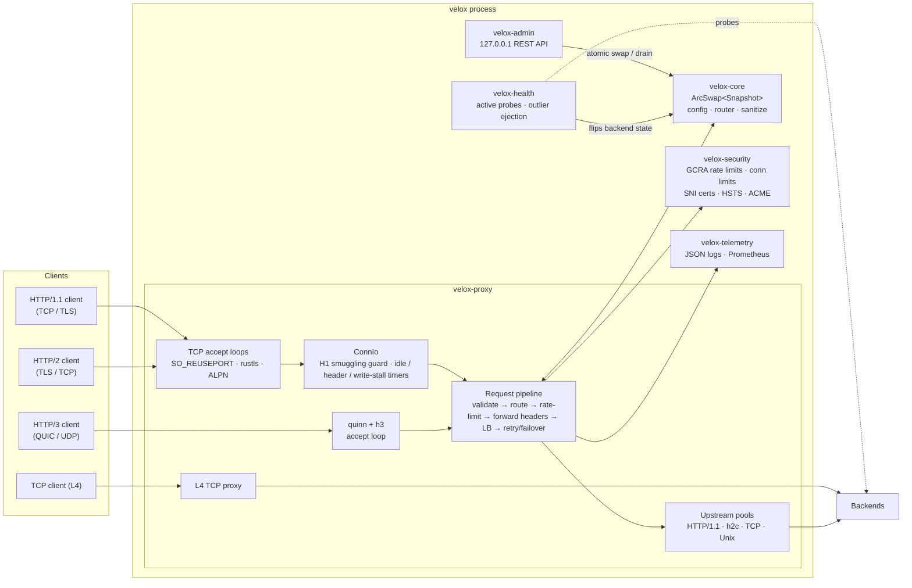

# Velox

**A memory-safe reverse proxy and L4/L7 load balancer in pure Rust.**
HTTP/3 + HTTP/2 + HTTP/1.1 at the edge, pooled HTTP/1.1 / h2c / Unix sockets to your backends, zero-reload configuration, and request-smuggling defences that don't rely on the HTTP library's good manners.

| | |
|---|---|
| **Memory safety** | `#![forbid(unsafe_code)]` in every crate. TLS is `rustls` (no OpenSSL). No `unwrap`/`expect`/`panic` in library code — enforced by `clippy` in CI. |
| **Smuggling-proof parsing** | HTTP/1 bytes are validated *before* `hyper` sees them. Ambiguous framing (CL+TE, TE.TE, duplicate/odd `Content-Length`, obs-fold, bare LF, NUL, `Transfer_Encoding`…) is rejected with a clean 4xx — and **not one byte of a rejected request reaches your backend**. |
| **Zero-reload config** | Lock-free `arc-swap` snapshots. Edit `velox.toml` (`velox reload` / `SIGHUP`) or call the admin API. In-flight requests finish on the config they started with; keep-alive connections never drop; an invalid change is rejected with no side effects. |
| **Edge protocols** | HTTP/3 (QUIC, `quinn` + `h3`), HTTP/2 and HTTP/1.1 (`hyper`). TCP responses advertise `Alt-Svc: h3=":443"; ma=86400`. |
| **Load balancing** | Weighted round-robin, least-connections, power-of-two-choices, consistent hashing (Ketama ring). Active health checks with jitter + hysteresis, passive outlier ejection with exponential back-off. |
| **Operable** | Prometheus `/metrics`, JSON logs with `X-Request-Id` correlation, graceful drain on `SIGTERM`, localhost-only admin API. |

---

## Contents

- [Quickstart](#quickstart)
- [Architecture](#architecture)
- [Security model](#security-model)
- [Configuration](#configuration)
- [Admin API](#admin-api)
- [Operations](#operations) (signals, reloads, draining, metrics, logs)
- [Docker](#docker)
- [ACME / Let's Encrypt](#acme--lets-encrypt)
- [Testing](#testing) (unit, end-to-end, property tests, fuzzing)
- [Benchmarks](#benchmarks)
- [Known limitations](#known-limitations)

---

## Quickstart

```bash
# Rust 1.88+
cargo build --release          # → target/release/velox  (~7 MB, stripped)
cargo test --workspace --all-features

# two throwaway backends
python3 -m http.server 3000 &  python3 -m http.server 3001 &

./target/release/velox validate -c velox.toml   # checks everything, reports all problems at once
./target/release/velox start    -c velox.toml
```

```bash
curl -i  http://127.0.0.1:8080/                       # HTTP/1.1
curl -ik https://127.0.0.1:8443/ --http2              # HTTP/2 (self-signed dev cert); note the Alt-Svc header
curl -ik https://127.0.0.1:8443/ --http3-only         # HTTP/3 (needs a curl built with HTTP/3)

curl -s http://127.0.0.1:9901/admin/v1/upstreams | jq # live view of every backend
curl -s http://127.0.0.1:9901/metrics | head          # Prometheus
./target/release/velox reload                         # re-read velox.toml, no dropped connections
```

CLI:

| Command | What it does |
|---|---|
| `velox start -c velox.toml` | Run. `SIGTERM`/`SIGINT` drain gracefully, `SIGHUP` reloads. |
| `velox validate -c velox.toml` | Validate (including that cert files exist). Exit code ≠ 0 on any problem. |
| `velox reload [-c velox.toml] [--admin 127.0.0.1:9901]` | Ask a running instance to re-read its file via the admin API (`VELOX_ADMIN_TOKEN` is honoured). |
| `velox version` | Print the version. |

The annotated [`velox.toml`](velox.toml) documents every option.

---

## Architecture



### Crates

| Crate | Responsibility |
|---|---|
| [`velox-core`](crates/velox-core) | `velox.toml` schema + validation; `SharedState` (`ArcSwap<Snapshot>`); host/path router; backend runtime state; **`sanitize`**: the strict HTTP layer (wire-level HTTP/1 guard, typed header validation, hop-by-hop stripping, `X-Forwarded-*`/`Forwarded` handling). |
| [`velox-proxy`](crates/velox-proxy) | Dual-stack listeners (TCP + UDP), TLS/ALPN, HTTP/1.1 · HTTP/2 · HTTP/3 front-ends, the request pipeline, load balancers, pooled upstream clients (TCP/Unix, h1/h2c), WebSocket tunnelling, L4 proxy, graceful shutdown. |
| [`velox-health`](crates/velox-health) | Background TCP/HTTP probes (interval, timeout, jitter, thresholds) and passive outlier detection. |
| [`velox-security`](crates/velox-security) | Lock-free token-bucket rate limiting (GCRA on `DashMap` + atomics), per-IP/global connection caps, `rustls` SNI resolver with hot-swappable certs, HSTS/security headers, ACME HTTP-01. |
| [`velox-telemetry`](crates/velox-telemetry) | `tracing` JSON logging and the `velox_*` Prometheus registry. |
| [`velox-admin`](crates/velox-admin) | Localhost REST API and the optional metrics-only listener. |
| [`velox-cli`](crates/velox-cli) | The `velox` binary (`start`, `validate`, `reload`, `version`) and the `App` that wires everything (also used by the end-to-end tests). |

### Request lifecycle

1. **Accept** — per-IP and global connection caps (IPv6 grouped by /64); `TCP_NODELAY` + keep-alive probes; TLS/QUIC handshake under a deadline.
2. **Guard** (HTTP/1) — `ConnIo` withholds each request head until it is complete *and* valid, then releases it to `hyper`. See [Security model](#security-model).
3. **Validate** — typed checks for every protocol (`Host`/`:authority` agreement, CL/TE rules, connection-specific headers in h2/h3, header-count cap).
4. **Route** — one `ArcSwap` load; exact host → wildcard → catch-all, longest path prefix on segment boundaries.
5. **Rate limit** — GCRA bucket per client IP or header value → `429` + `Retry-After`.
6. **Forward headers** — hop-by-hop stripped (including `Connection`-nominated names), `X-Forwarded-For/Proto/Host`, `X-Real-IP`, RFC 7239 `Forwarded` rebuilt (untrusted peers cannot spoof them), `X-Request-Id` minted or propagated.
7. **Balance + forward** — pick a backend, send over a pooled connection, fail over to *another* backend on connect errors (and on timeouts for idempotent requests); record the outcome for outlier detection.
8. **Respond** — hop-by-hop stripped, HSTS / `nosniff` / `Alt-Svc` / `X-Request-Id` added, body streamed under an idle-timeout, metrics and access log emitted.

Every failure maps to one status: `400/431/501` (rejected input), `404` (no route), `408`, `413`, `429`, `502`, `503`, `504`. Nothing on this path can panic.

---

## Security model

### Request smuggling

Smuggling needs two parties to disagree about where a request ends. Velox removes the disagreement instead of hoping both sides normalise the same way:

* **Before `hyper`.** `velox-core::sanitize::h1` is a sans-IO state machine fed every byte read from the client. It tracks message boundaries across keep-alive and pipelining (Content-Length bodies, chunked bodies including trailers) and enforces, per RFC 9110/9112:
  * exactly one `Host` (HTTP/1.1), syntactically valid (no userinfo, spaces, paths…);
  * at most one `Content-Length`, digits only; **never** together with `Transfer-Encoding`;
  * `Transfer-Encoding` must be exactly `chunked` (so `xchunked`, `chunked, identity`, `\x0bchunked`… are refused; a clean-but-unsupported coding list is a `501`);
  * no obs-fold, no bare CR/LF, no NUL/control bytes, no `Connection: Content-Length`-style nominations, no `Transfer_Encoding`-style aliases;
  * origin-form request targets only; `CONNECT`/`TRACE` refused; hard caps on head size, header count and URI length;
  * chunk sizes are strict hex with an overflow bound; trailers may not smuggle framing headers.
* **Partial heads are withheld.** A request head is held back until the *entire* head has been validated. This closes the classic gap where early bytes of a poisoned head are forwarded before the violating header arrives. A rejection is delivered to `hyper` as a synthetic `Connection: close` request so the client gets a normal `400`, and the attacker's bytes are discarded. (Integration test: nothing from a poisoned pipelined chunk reaches the backend.)
* **After `hyper` — and for h2/h3.** The same rules run on typed headers, plus h2/h3-specific ones (no `Connection`, `Keep-Alive`, `Transfer-Encoding`, `Upgrade`, `TE` ≠ `trailers`; `:authority` must match `Host`).
* **WebSocket upgrades** are honoured only for `Upgrade: websocket` (never `h2c`), must carry no body, and if the backend declines the upgrade the connection is closed rather than reused.

### Denial of service

Every stage has a bound — see `[limits]` and `[timeouts]` in [`velox.toml`](velox.toml): TLS/QUIC handshake, **header read (Slowloris)**, idle keep-alive, client body idle, upstream connect, upstream response, upstream body idle, **write stall (slow-read)**; max header bytes/count/URI, body size, connections (global and per IP), concurrent streams; HTTP/2 rapid-reset limits; QUIC address validation under load; bounded rate-limiter memory (overflow bucket).

### Admin API

Loopback bind (enforced when the config is validated *and* when binding), loopback peer check, `Host` must be a loopback name (DNS-rebinding), requests with `Origin`/`Sec-Fetch-Site` are refused (browser CSRF), JSON content-type required for bodies, constant-time bearer-token check (`admin.token_env`), 1 MiB body cap.

---

## Configuration

See the commented [`velox.toml`](velox.toml). Highlights:

```toml
[[upstream]]
name      = "app"
algorithm = "p2c"                    # round_robin | least_conn | p2c | consistent_hash
backends  = [{ addr = "10.0.0.5:8080", weight = 2 }, { addr = "unix:/run/app.sock" }]
[upstream.health]  { path = "/healthz", interval = "5s", jitter = 0.2, healthy_threshold = 2, unhealthy_threshold = 3 }
[upstream.outlier] { consecutive_failures = 5, base_ejection_time = "30s", max_ejection_percent = 50 }

[[route]]
hosts = ["example.com", "*.example.com"]
path_prefix = "/api"
strip_prefix = true
upstream = "app"
rate_limit = { requests_per_second = 20.0, burst = 40, key = "header:x-api-key" }
```

**What reloads live?** Routes, upstreams (including backend sets/weights/algorithms), health and outlier settings, rate limits, limits and timeouts for *new* connections/requests, response headers, trusted proxies, TLS certificates. **What needs a restart?** Listener addresses (`http_addr`, `https_addr`, `h3`, `h3_addr`, `[[tcp_proxy]]` listeners). A reload that changes them applies everything else and logs a warning.

Backends that are unchanged across a reload keep their runtime state (health, drain flag, in-flight counters, ejection history) — a reload never "forgets" a drained or ejected node.

---

## Admin API

All under `http://127.0.0.1:9901`. Mutations take `Content-Type: application/json`. Failed validation → `422` and nothing changes.

| Method & path | Purpose |
|---|---|
| `GET /admin/v1/status` | version, config generation, uptime |
| `GET /admin/v1/config` | the live configuration as JSON |
| `POST /admin/v1/reload` | re-read `velox.toml` (what `velox reload` calls) |
| `GET /admin/v1/upstreams`, `GET …/{name}` | live state: health, drain, ejection, in-flight and lifetime counters per backend |
| `PUT /admin/v1/upstreams/{name}` | create or replace an upstream |
| `DELETE /admin/v1/upstreams/{name}` | remove (`409` while a route still uses it) |
| `POST /admin/v1/upstreams/{name}/backends/{addr}/drain` · `undrain` · `reset` | stop sending new requests (in-flight finish) · resume · clear ejection and mark healthy. `{addr}` is URL-encoded (`10.0.0.5%3A8080`) |
| `GET /admin/v1/routes` | routes with their ids |
| `PUT /admin/v1/routes` · `POST /admin/v1/routes` | replace all · append one |
| `PUT /admin/v1/routes/{id}` · `DELETE …/{id}` | replace · remove one |
| `GET /metrics`, `GET /healthz` | Prometheus text, liveness |

```bash
# Blue/green cut-over with zero dropped requests
curl -X PUT localhost:9901/admin/v1/upstreams/green -H 'content-type: application/json' \
     -d '{"name":"green","backends":[{"addr":"10.0.1.5:8080"}]}'
curl -X PUT localhost:9901/admin/v1/routes/site     -H 'content-type: application/json' \
     -d '{"upstream":"green"}'
# Take a node out of rotation, let it finish, then upgrade it
curl -X POST localhost:9901/admin/v1/upstreams/app/backends/10.0.0.5%3A8080/drain
```

API edits live in memory; the file is the source of truth for the next `velox reload`.

---

## Operations

* **Signals** — `SIGTERM`/`SIGINT`: stop accepting, send HTTP/2 `GOAWAY` / HTTP/3 `GOAWAY`, finish in-flight requests, exit `0` (after `server.drain_timeout` stragglers are closed). `SIGHUP`: reload the file.
* **Metrics** (`/metrics`)

  | Metric | Labels |
  |---|---|
  | `velox_http_requests_total` | `protocol` (`h1`/`h2`/`h3`), `status` |
  | `velox_http_request_duration_seconds` (histogram) | `protocol` |
  | `velox_upstream_responses_total` | `upstream`, `code` (`error` = no response) |
  | `velox_upstream_request_duration_seconds` (histogram) | `upstream` |
  | `velox_active_connections`, `velox_connections_total` | `protocol` |
  | `velox_connections_rejected_total` | |
  | `velox_tls_handshake_errors_total` | `transport` (`tcp`/`quic`), `reason` |
  | `velox_rate_limited_total` | `route` |
  | `velox_rejected_requests_total` | `reason` (e.g. `cl-te-conflict`) |
  | `velox_config_reloads_total`, `velox_config_generation` | `result` |
  | `velox_upstream_backend_healthy` / `_active_requests` / `_ejected` | `upstream`, `backend` |
  | `velox_upstream_backend_ejections_total` | `upstream`, `backend` |
  | `velox_h3_enabled` | |

* **Logs** — one JSON object per line. Each request produces an access-log event (`target: "velox::access"`) with `request_id`, `method`, `host`, `path`, `status`, `duration_ms`, `protocol`, `client_ip`, `route`, `upstream`, `backend`, `error`. The same `request_id` is sent upstream and returned to the client as `X-Request-Id` (an inbound value is reused only if it is a safe token ≤ 128 chars).

---

## Docker

```bash
docker build -t velox .
docker run --rm -p 8080:8080 -p 8443:8443 -p 8443:8443/udp velox
docker run --rm -v "$PWD/velox.toml:/etc/velox/velox.toml:ro" -p 8080:8080 -p 8443:8443 -p 8443:8443/udp velox
docker kill --signal=HUP <container>          # reload
```

Multi-stage build (`rust:slim` → `gcr.io/distroless/cc-debian12:nonroot`): no shell, no package manager, unprivileged user. Container defaults live in [`docker/velox.toml`](docker/velox.toml) (ports above 1024 because the image is not root).

---

## ACME / Let's Encrypt

Build with `--features acme` (`cargo build --release -p velox-cli --features acme`), add a `[tls.acme]` block, and keep `http_addr` reachable on port 80. Velox registers an account, answers HTTP-01 challenges on the cleartext listener (`/.well-known/acme-challenge/*`), writes the key (mode `0600`) and chain to `cache_dir`, installs the certificate into the SNI resolver **without a restart**, and renews ~30 days before expiry (renewal timing is derived from the cached file's age, assuming 90-day certificates). Use the Let's Encrypt *staging* `directory_url` while testing. Wildcard names need DNS-01 and are rejected by validation.

Honest status: the issuance flow is compiled and unit-tested (cache handling, resolver installation, unreachable-CA behaviour) but **has not been exercised against a live ACME CA** in this repository's tests.

---

## Testing

```bash
cargo test --workspace --all-features
cargo clippy --workspace --all-targets --all-features -- -D warnings
cargo fmt --all -- --check
```

| Layer | What is covered |
|---|---|
| **Unit** (`velox-core`) | Config validation; router precedence; atomic swap (including concurrent readers); **~25 smuggling cases** (CL.TE, TE.CL, TE.TE variants, duplicate CL, obs-fold, bare LF/CR, NUL/control bytes, underscore aliases, `Connection`-nominated framing headers, absolute-form, CONNECT/TRACE, size/count caps, chunk and trailer abuse); forwarded-header anti-spoofing; hash-ring stability. |
| **Property + mutation fuzz** (stable, in `cargo test`) | Guard never panics; verdict **and released bytes** independent of TCP segmentation; "accepted ⇒ unambiguous" invariants checked over 150 000 mutated smuggling seeds and 60 000 chunked streams. |
| **Unit** (others) | Load-balancer distribution (exact weighted RR, least-conn, P2C bias, hash minimal-disruption); GCRA bucket maths incl. 8-thread contention; connection limits; TLS SNI/reload; outlier back-off; probes; `ConnIo` timers (paused-time tests). |
| **Data plane** (`velox-proxy/tests`) | Real sockets: header rewriting, every attack in the smuggling list vs. a backend hit-counter (**must stay 0**), round-robin and failover, outlier ejection, 429, body limits, WebSocket tunnel, graceful drain, Slowloris, idle reaping, per-IP limits, Unix-socket upstream, 504. |
| **End-to-end** (`velox-cli/tests`) | **HTTP/1.1, HTTP/2 and HTTP/3** with real TLS/QUIC clients (incl. 100 KB uploads, 50 multiplexed streams, `Alt-Svc`, protocol metrics, cert hot-reload); failover + active-health recovery; passive ejection + admin reset; **zero-failure reconfiguration under load** (8 keep-alive connections across API edits, file reload and a rejected bad reload, with an in-flight request straddling the cut-over); consistent-hash pinning + drain; L4 proxy; and the **real `velox` binary** under `SIGTERM` (in-flight request completes, exit 0), `SIGINT`, `SIGHUP`, `velox reload`, `velox validate`. |
| **Fuzz targets** (`fuzz/`) | `cargo-fuzz` targets for the request head, the guard stream, chunked framing and typed headers, with a smuggling seed corpus in `fuzz/seeds/`. CI runs them weekly for 3 minutes each on nightly. |

Run coverage-guided fuzzing locally:

```bash
cargo install cargo-fuzz && rustup toolchain install nightly
cargo +nightly fuzz run request_head fuzz/seeds
```

---

## Benchmarks

### Micro-benchmarks (`criterion`)

```bash
cargo bench -p velox-core    # head parsing, guard, hop-by-hop, forwarded headers, router, snapshot load
cargo bench -p velox-proxy   # LB selection (4/32/128 backends) and rate-limit checks
```

Measured on an Apple-silicon laptop (single thread, release):

| Operation | Time |
|---|---|
| Parse + validate a typical request head (8 headers) | ~290 ns (≈800 MiB/s) |
| Same, through the stateful guard | ~520 ns |
| Hop-by-hop strip / `X-Forwarded-*`+`Forwarded` rewrite | ~260 ns / ~560 ns |
| Route lookup, exact host among 500 routes / wildcard+prefix | ~32 ns / ~22 ns |
| Load config snapshot (`ArcSwap`) | ~4.4 ns |
| LB pick, 32 backends: round-robin / consistent-hash / P2C / least-conn | ~24 ns / ~28 ns / ~103 ns / ~101 ns |
| Rate-limit check (GCRA, 1 024 keys) | ~30 ns |

### End-to-end throughput

```bash
bench/run.sh 10 64        # duration (s), connections
```

Starts two minimal hyper backends (`crates/velox-cli/examples/bench_backend.rs`) and Velox (`bench/velox.bench.toml`), then drives load with the best of `oha` / `wrk` / `ab`, first against a backend directly (baseline) and then through Velox. For serious numbers use a separate load generator host and `oha`/`wrk`, plus `h2load` for HTTP/2 and HTTP/3.

Smoke measurement on the same laptop, loopback, `ab -k -c 64` (single-threaded client, so treat as indicative): **≈ 317 k req/s direct vs ≈ 105 k req/s through Velox, 0 failed requests**, mean latency 0.6 ms at 64 connections. The gap is the proxy's per-request work (validation, routing, header rewrite, pooled upstream hop) on a machine that is also running the client and both backends.

---

## Known limitations

* **Listener addresses need a restart**; everything else reloads live (see above).
* **No TLS to upstreams** (by design of the brief: pooled h1/h2c over TCP/Unix). Terminate TLS at the backend's sidecar or use a private network.
* **DNS names** in `backends` are resolved by the OS resolver on each *new* upstream connection; there is no background DNS refresh or SRV discovery. IP literals and Unix sockets are the fast path.
* **HTTP/2 upstream uses `:authority` = backend address** (the original host travels in `X-Forwarded-Host`); HTTP/1 upstreams receive the original `Host`.
* **HTTP/2 over cleartext (h2c) on the client side** is not served — HTTP/2 is negotiated via ALPN on the TLS listener.
* **Streaming uploads are not retried**: only bodies up to `retry_body_buffer_bytes` with a known length are replayable on another backend; others get a single attempt.
* **ACME** is not tested against a live CA (see above); wildcard certificates (DNS-01) are unsupported.
* **Dockerfile** is built in CI; it was not built on the machine this was developed on (no Docker daemon was running).
* Coverage-guided fuzzing runs in CI on nightly; the stable test-suite uses deterministic mutation fuzzing instead.

## License

Dual-licensed under [MIT](LICENSE-MIT) or [Apache-2.0](LICENSE-APACHE), at your option.
